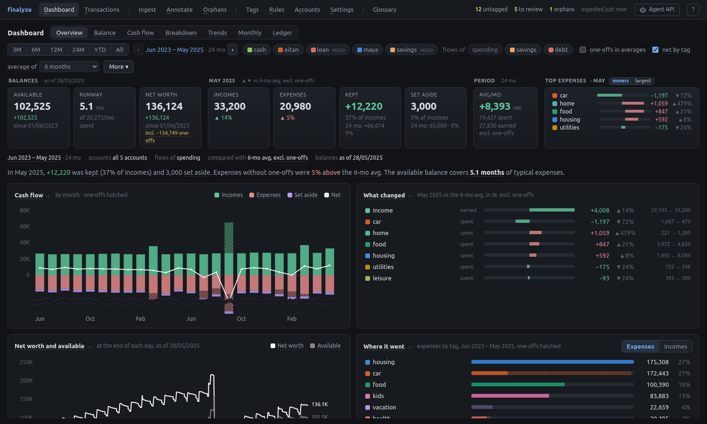
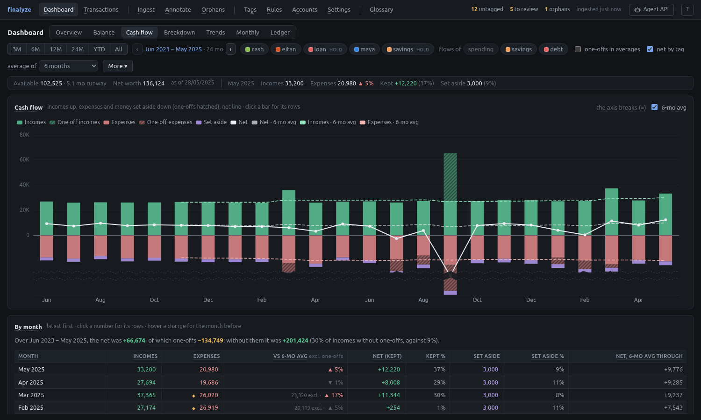
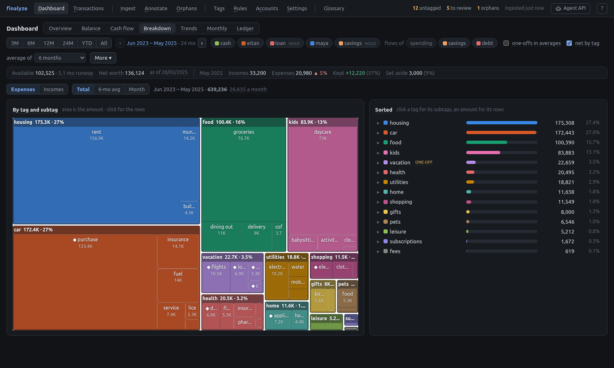

# Finalyze
A bespoke personal financial analysis tool.





Originally a small script meant to parse files exported from the bank website and produce simple graphs for personal financial planning. It has grown in scope to be quite elaborate, but still intended for my own personal financial planning.

## Usage
Install with [uv][uv] (recommended):
```
uv tool install git+https://github.com/ArielHorwitz/finalyze
```
Or via pip (in which case it is recommended to use a [virtual environment][venv]):
```
pip install git+https://github.com/ArielHorwitz/finalyze
```
Then serve the web app (see [Web app](#web-app) to build it) and ingest the raw files from its **Ingest** page:
```
finalyze  # optionally: -C <config dir>, --host, --port (default 8765), --demo
```

Put each account's raw files (bank exports) in a folder named after it, in the raw folder (by default `~/.local/share/finalyze/raw/<account>/`), or upload them from the Ingest page.

`finalyze` is the only command: everything else is done in the web app, or by agents through the [HTTP API](#http-api).

### Demo
To try the app without data of your own, or to show it off, serve the demo:
```
finalyze --demo
```
It generates an invented household into a temporary directory (its config, host file, raw folder and store) and serves the whole app on it. Edits work, on that copy, and are lost when the server stops. Your own config and data are neither read nor written. The header shows a **Demo** badge.

The household is Maya and Eitan, who bank separately and keep one household, with their son and their dog: two years of their checking accounts and cards (as the bank's .xls exports), Maya's Bit payments (the app's CSV export), a cash wallet, savings and a car loan (hand-written CSVs). Its ingestion rules turn card charges and Bit, cash, savings and loan payments into transfers, its opening balances and a count of the wallet are reconciliations, and most of it is annotated: rules for the routine, tags, descriptions, splits and one-offs for the rest, a few annotations flagged for review by an agent, and the current month's last few transactions left untagged. It is the same for a given end date: `python -m finalyze.demo DIR --end-date YYYY-MM-DD` writes it into a directory instead (see `finalyze/demo/`).

### Where the data is, and the config
finalyze keeps three kinds of state apart:

- **Data**: the store and the raw files.
- **Preferences**: the config file, how raw exports are read. It holds no paths.
- **Host**: where things are on this machine, in the host file. It is never exported, and never in the config or the store.

The host file is `host.toml`, next to the config (`~/.config/finalyze/`, another dir with `-C`). Without it, the defaults apply:

| Option | Meaning |
| --- | --- |
| `data_dir` | Where the store (`finalyze.db`), the ingested data (`ingested/`, with `ingest-times.json`: when an ingest last changed it, and last ran) and the backups (`backups/`) live. Default `~/.local/share/finalyze` |
| `raw_dir` | The raw folder (default `<data_dir>/raw`). Not the data directory, nor a folder holding it, since an import replaces its contents |
| `host`, `port` | Where to serve (default `127.0.0.1` and `8765`). `--host` and `--port` win |

For example:
```toml
data_dir = "~/.local/share/finalyze"
raw_dir = "~/finances/raw"
```

**The raw folder** holds a folder per account: `raw/<account>/`, whose files are that account's raw files (not those in its subfolders, nor hidden ones). Accounts appear by making folders, or by uploading files for a new account on the Ingest page. An account that only ingestion rules transfer rows to (`to_account`) needs an empty folder: without one, ingesting fails and says so. A file in the raw folder itself, outside every account's folder, isn't ingested (the Ingest page flags it).

The Settings page shows the host file's values, read-only: they are edited in the file, and apply when the server starts.

A config file with default values is written to `~/.config/finalyze/config.toml` if missing. It holds how the raw files are read:

| Option | Meaning |
| --- | --- |
| `ingestion.rules` | Reshape the parsed rows before ingesting: drop them, change their raw description or date, or turn them into transfers to another source (see below) |
| `ingestion.filters` | Leave rows out when ingesting (after the rules), e.g. `start_date = "2024-04-01"` |

#### Ingestion rules
Parsers only read their files, one row per transaction. Ingestion rules then reshape the rows of every account, before the filters. Each row goes by the first rule whose `match` (a filter: dates, account, source, raw description) it meets:

- `drop`: leave it out.
- `transfer`: the row is money moving to another source, e.g. the monthly card charge in checking pays the card. It stays as its own source's leg, and a row of the opposite amount is added in `to_source` (of `to_account`, by default the same account).
- `rewrite`: only change it.

Any of them but `drop` can set a new `raw_description` and move the date by `shift_days`. Rules only reshape rows: their meaning (tags, kinds, descriptions) is for tagging. Rows keep the ID of the parsed row, so changing a rule doesn't orphan annotations, and rules never apply to the rows a rule added. For example, a card that pays for Bit payments, and checking that pays the card:

```toml
[[ingestion.rules]]
match = { source = "checking", raw_description = "^לאומי ויזה$" }
action = "transfer"
to_source = "card"
raw_description = "Transfer checking-card"

[[ingestion.rules]]
match = { source = "card", raw_description = "^BIT$", start_date = "2025-01-01" }
action = "transfer"
to_source = "bit"
raw_description = "Transfer card-bit"
```

A tagging rule on `^Transfer` with a tag of the `transfer` kind then tags both legs. A transfer rule for a period without data of the other source makes its spending vanish (the card's rows become transfers, with no payments in the other source), hence the `start_date`.

The web app's **Settings** page edits these too, validated before they are written. Saving rewrites the file without its comments (the previous file is kept as `config.toml.bak`). Unknown settings (e.g. of an older version) are refused, each named, so the server doesn't start until they are removed from the file. The paths older versions had in the config (`general.data_dir` and `ingestion.directories`) are refused with a message saying where they went: move `data_dir` to the host file, and the accounts' files into the raw folder's account folders.

The dashboard's defaults (netting by tag, the rolling average, the monthly view's months, monthly figures of complete months only), the colors of chart labels and the web app's date format (`dd/mm/yyyy` by default, or `yyyy-mm-dd` or `mm/dd/yyyy`, for display and date fields only: URLs and the API keep ISO dates) are in the store, set on the Settings page.

### Export, import and backups
The Settings page (or the API, see `/agent.md`) **downloads** an export of the whole instance, one zip, to keep a copy or to move to another machine: a snapshot of the store (safe while serving), the ingested data, the raw folder (`raw/<account>/`), the config file and a `manifest.json`, but never the host file. It holds all the data, so keep it private.

**Importing** uploads an export, and replaces everything with it. It checks the zip first (a dry run, by default through the API) and writes nothing if it is invalid, including any file outside the folders it belongs in. The confirmation lists the raw files it replaces and removes. Then it backs up the current state (unless unchecked), makes the raw folder hold exactly the export's raw files (files it doesn't have are removed, since any folder left would be ingested as an account; hidden entries of the raw folder stay), replaces the config file with the export's (the host file stays), and replaces the ingested data and the store. The raw folder's contents are swapped through a hidden folder inside it, so if a step fails, the earlier ones are undone and the raw folder is as it was. Other requests wait while it runs, and the server serves the new data as soon as it ends. Imports take zips of up to 1 GiB (4 GiB unpacked).

**Backups** are exports kept on this machine (`<data_dir>/backups/`), each with a unique name, listed on the Settings page to restore, download or delete. They are made on request, and before every import or restore unless unchecked (named `before import on <date>` by default). Restoring one is importing it, with the same checks and confirmation. At most 10 are kept and none is ever deleted automatically: at the limit, new backups are refused (and so are imports and restores that ask for one) until one is deleted, and the list warns ahead of it. Files that ingesting ignores (hidden ones, those in subfolders of accounts, and those outside account folders) are in no backup: an import or a restore that removes them says so.

Everything moves through downloads and uploads: no endpoint takes a path, and the server only reads and writes its own folders (those of the host file), which works the same whether it runs on this machine or elsewhere.

## Pipeline
- **Ingest**: Import data from exported files. Supports excel (.xls) file exports from Leumi bank, CSV exports from the Bit app (as a `bit` source, in the Bit balance's terms), and CSV files.
- **Annotate**: Tag transactions, split them and describe them, on the Annotate and Transactions pages, by rules, or by agents through the API.
- **Analyze**: The interactive [dashboard](#dashboard).



*The dashboard, over the demo's data (see [Demo](#demo)).*

Transactions are derived from the raw files when ingesting. Only user-authored state is stored, in `<data_dir>/finalyze.db`: annotations (tags and descriptions), tag and account properties, account groups, and rules that tag transactions automatically. Opening the store upgrades its schema to the current version, if it is older (and not older than the oldest supported version, which fails with a message that says so).

### Account groups and tag kinds
Every account is in one **group**, and a group's **role** says what its money is:
- **spending**: day-to-day money. Its accounts make up the cash flows, breakdowns and trends, and the **available** balance.
- **holding**: savings, investments or debt. Only in the **net worth**, which is every group's balance.

New accounts go to the first spending group (`spending` at first). Groups are managed on the Accounts page, and the dashboard can show the flows of any groups.

Every tag has a **kind** (a subtag can have its own, or inherit its tag's):

| Kind | Incomes and expenses, breakdowns | Averages and trends | Balances | For |
| --- | --- | --- | --- | --- |
| `regular` | Yes | Yes | Yes | Day-to-day incomes and expenses |
| `transfer` | No | No | Yes | Money between own accounts, loans (both sides recorded) |
| `saving` | No: shown as *set aside* (from the spending groups), with its share of incomes | No | Yes | Money set aside |
| `one-off` | Yes, marked | Only with *include one-offs* | Yes | Rare large incomes or expenses, e.g. a wedding or a car |
| `reconciliation` | No | No | Yes | Rows that re-anchor a balance, with no other side: opening balances, a wallet counted short of its rows |

A balance's re-anchoring row is the counted amount less the balance on that date, which *Balance on* on the Accounts page (or `GET /api/balance`) gives. Reconciliations have their own term in the bridge, and are never flagged as transfers with one side.

A kind can also be **set on one transaction** (on its annotation's parts), over its tag's: e.g. one big purchase tagged `home/furniture`, marked `one-off` without a subtag of its own. Every figure uses the effective kind (set on the transaction, else the subtag's own, else the tag's). Rules only give tags, so a rule's transactions can't have one. Set it in the web app (`O` toggles one-off) or with the API, and filter by it on the Transactions page.

## HTTP API
```
finalyze  # optionally: -C <config dir>, --host, --port (default 8765), --demo
```
`--demo` serves an invented household instead of your data (see [Demo](#demo)). In a checkout of the repository, `finalyze` warns when the built web app is older than its sources (rebuild it with `./scripts/build-web.sh`), and so does the web app, in a banner.
The API is served at `http://127.0.0.1:8765/api`, for a single local user and without authentication, so it binds to localhost by default. Writes that a browser sends from another site are refused (403), so a web page can't post to it. Interactive documentation, which also explains the concepts, is at `/docs` (the schema is at `/openapi.json`). The [web app](#web-app) is served at `/` once built.

Instructions for agents are at `/agent.md` (e.g. `http://127.0.0.1:8765/agent.md`, also in the web app's header, under the **Agent API** button or `@`, to copy the URL): Markdown, generated for the instance's address, covering the data model and every endpoint with `curl` examples. Point an agent at it to operate the API. It only describes what the API does, not how to go about a task.

Reads use the last ingested data and the current store, so writes are visible immediately. The raw files are only parsed again on `POST /api/ingest` (or the Ingest page). `GET /api/ingest/dry-run` and `GET /api/ingest/preview` check them first, without writing anything. Nothing is tagged automatically: guesses are only suggestions on untagged transactions, from the annotated transaction with the same raw description nearest in date.

Annotations record their authors (everyone who changed their content: `owner` by default, an agent passes its name, and changing only the review flag doesn't count) and can be flagged for review. Writes can change only some fields of an annotation (a patch), keeping the rest, or replace it whole. A transaction's raw description is its text in the raw files (often vague), and its description, in its annotation, is what it really was (written by the owner or an agent). An annotation without parts is only a description, and its transaction stays untagged.

| Area | Endpoints |
| --- | --- |
| Status | `GET /api/status`, `POST /api/ingest`, `GET /api/server` (demo, stale web app), `GET /api/glossary` (what every figure and label means, see [below](#glossary)), `GET /api/ingest/dry-run` (each raw file parsed on its own, with likely problems), `GET /api/ingest/preview` (the transactions that would appear, vanish or change, and the annotations that would be orphaned) |
| Transactions | `GET /api/transactions` (filters, sorting, pagination), `POST /api/transactions/query` (same, JSON body), `GET /api/transactions/{id}` |
| Annotations | `PUT` and `DELETE /api/transactions/{id}/annotation`, `POST /api/annotations/batch` (atomic), `/clear`, `/review`, `/kind` (set a kind on transactions, or clear it), `/bulk` (change the tags, kind, description or review flag of a query's results, each optional, previews by default) |
| Tags | `GET`, `POST` and `PATCH /api/tags`, `POST /api/tags/rename`, `/merge`, `/delete` |
| Accounts | `GET /api/accounts`, `PATCH /api/accounts/{name}` (group, color), `GET /api/balance` (of an account, source, group or the net worth, at the end of a date), `GET` and `POST /api/groups`, `PATCH` and `DELETE /api/groups/{name}` |
| Rules | `GET` and `POST /api/rules`, `GET`, `PATCH` and `DELETE /api/rules/{id}`, `POST /api/rules/reorder`, `/preview` |
| Orphans | `GET /api/orphans`, `POST /api/orphans/delete`, `GET /api/overridden` |
| Analysis | `GET /api/analysis/rows` (enriched rows, one per split part), `GET /api/analysis/aggregate` |
| Dashboard | `POST /api/dashboard` (every table of the dashboard over a period, unset options take the defaults), `POST /api/dashboard/rows` (the rows behind one of its numbers) |
| Raw files | `POST /api/raw/{account}` (upload raw files into an account's folder: checked by the parsers first, replacing files only when asked) |
| Settings | `GET` and `PUT /api/settings/dashboard` (the dashboard's defaults), `/display` (the web app's date format), `/colors` (label colors), `/config` (the config file, validated, rewritten without comments), `GET /api/settings/host` (where the data is, read-only) |
| Export, import and backups | `GET /api/export` (download), `POST /api/import` (upload, checks by default), `GET` and `POST /api/backups`, `GET` and `DELETE /api/backups/{file}`, `POST /api/backups/{file}/restore` (checks by default) |

## Web app
A keyboard-driven app for annotating transactions and managing tags, rules and accounts, served by `finalyze` at `http://127.0.0.1:8765/`. Build it once (and after updating), which needs [Node.js][node] 22 or later:
```
./scripts/build-web.sh
finalyze
```

Pages, in the nav's four groups (the app opens on the dashboard):
- See:
  - **Dashboard**: balances, cash flow, breakdowns and trends, interactively (see [below](#dashboard)).
  - **Transactions**: search with every filter, edit any annotation, and *batch apply* tags, a kind, a description or the review flag (each optional, e.g. only one-off) to the selected transactions (or, as a separate choice in the dialog, to all those matching the filters, over every page), previewed before committing.
- Routine:
  - **Ingest**: the raw folder's path (to copy), an upload of raw files (checked by the parsers first, all written or none, and a file of the same name is replaced only once you confirm, comparing both files' dates and rows), per account its folder and files (size, modified time), and a dry run of each: the parser that read it (or why each parser rejected it), rows (those kept by the ingestion rules and filters, and the transfer rows its rules add), dates and sum. It flags likely problems: unparseable or empty files, rules that transfer to an account without a folder, files outside the accounts' folders, files whose rows the ingestion rules and filters drop entirely, and files of the same account that share rows of a source in overlapping dates (likely duplicates, e.g. a period exported twice). Overlaps without shared rows, like those of two cards, are listed but not flagged. Before ingesting, it previews the effect: new, vanished, changed (same ID, other content) and unchanged transactions, and the annotations that would be orphaned. Checking only reads the raw files. The header's "ingested ... ago" only moves when an ingest changes the ingested data: one that changes nothing is only a check, shown in the hint's hover text and the Ingest page's result.
  - **Annotate**: every untagged transaction at once (or those flagged for review, or a custom filter). Each row has inputs for tag, subtag, description and kind (set on the transaction, over its tag's), pre-filled from the guess (in purple) but not applied until accepted. Edits are drafts until submitted together, in one atomic batch.
  - **Orphans** (and overridden annotations).
- Setup:
  - **Tags**: usage counts, color and kind (subtags inherit them unless they have their own), rename, merge and delete.
  - **Rules**: in order, with an editor that previews what a rule would newly tag and which annotations it would override.
  - **Accounts**: accounts in their groups, and the groups' names, roles, colors and order. *Balance on* shows the balance of an account, source, group or the net worth at the end of a date (e.g. to work out a reconciliation).
  - **Settings**: the date format (how every full date is shown and typed), the dashboard's defaults, the colors of its balance lines, the keyboard shortcuts, where the data is (read-only), the config file, export and import, and the backups.
- Reference:
  - **Glossary** (also linked from the shortcuts' help and from Settings): see [below](#glossary).

The header shows the untagged, to-review and orphan counts and data freshness, then two buttons: **Agent API** (`@`) shows the URL of the [agent instructions](#http-api), to copy and give an agent, and `?` shows the keyboard shortcuts.

### Keyboard
Press `?` on any page for the shortcuts available there. The mouse works too. Shortcuts are off while typing in a field (`Esc` leaves it), and letter and punctuation keys also work in other keyboard layouts (e.g. Hebrew), by their position on a US keyboard: once a letter typed shows the layout's script, even the keys that type punctuation there (Hebrew's `q` and `w`, `/` and `'`) are their US keys. Browser extensions with their own keys can take some first: Vimium, for one, keeps the digits as counts even with nothing mapped, so exclude the app's address in such an extension.

Every shortcut can be changed, in the **Keyboard shortcuts** section of Settings (`s` there): each is a named action (e.g. `tags.rename`) listed by page, whose keys are changed by pressing the new one, added to, cleared or reset. The four directions (down and up between rows, left and right between the breakdown's months, and with Shift, reordering) have a key each, vim's `h` `j` `k` `l` by default: change any of them, or set all four to `h` `j` `k` `l` or `j` `k` `l` `;` at once. The arrows always work too. Two actions active at once (on a page, or everywhere) can't share a key: the clash shows, and nothing is saved until it's resolved (the API refuses it too). Fixed keys keep their meaning and can't be bound: `Enter`, `Esc`, `Tab`, `Space`, `Backspace`, `Delete`, the arrows, `Home`, `End`, `PageUp` and `PageDown`. The keymap is kept in the store (`GET` / `PUT /api/settings/keymap`). The tables below give the defaults, with vim's directions.

| Keys | Action |
| --- | --- |
| `g` then a letter | Go to a page: the letter underlined in its name. `d` Dashboard, `t` Transactions, `i` Ingest, `a` Annotate, `o` Orphans, `g` Tags, `r` Rules, `c` Accounts, `s` Settings, `l` Glossary |
| `Ctrl+Enter` or `I`, `R`, `u` | Ingest: ingest, check the raw files again, upload raw files. `I` (shift+i) elsewhere ingests at once, without the preview |
| `@` | Show the agent instructions' URL: `Enter` copies it, `o` opens it |
| `j` / `k` (down / up, or arrows), `Home` / `End` | Move between rows |
| `Enter` or `i` | Edit the row, from its description: `Tab` / `Shift+Tab` move between its fields as their columns go, description, tag, subtag and kind (a split's parts: description, amount, tag, subtag, kind), and on to the next row |
| `Esc` | Leave the input or select, close a dialog or dropdown, or cancel a `g`. It never clears the selection |
| arrows, `Enter` | In a tag input: choose a suggestion. Typing part of a tag or subtag (or `tag/sub`) suggests pairs, and choosing one (`Enter` or a click) fills both and goes on past the subtag, to the kind. `Tab` picks only after moving in the suggestions, then goes to the next field as always |
| `Enter`, `Shift+Enter` | In a description: done with it, back to the rows (the edit stays a draft until submitted); a new line. Tables show a description's first line and `+2 lines` (for example), the whole description on hover |
| `a` / `A` | Accept the guess of the row (or the selected rows) / of every row shown |
| `r` | Toggle needs-review |
| `O` | Toggle one-off: set the row (or the selected rows) as a one-off, over its tag's kind, or back to the tag's. Also the ◆ button of a row or of a split's part, and the row's Kind column for any kind |
| `s` | Split: add a part. The first part takes the rest while its amount is empty, and `=` in a part's amount fills it with the rest. Amounts without a sign take the transaction's sign |
| `u`, `Delete` | Undo the row's edits, empty its tags and descriptions (deletes the annotation on submit) |
| `x` or `Space`, `X`, `Ctrl+a`, `Ctrl+Backspace` | Select the row, select and move down, select all rows shown, clear the selection (also the **clear** button by the count). Also on Orphans. Each view (each Annotate queue, Transactions with its filters, Orphans) keeps its own selection while the app is open, so looking elsewhere doesn't lose it. Narrowing the filters drops the selected rows that leave the view, and submitting clears it. Actions only touch the selected rows shown |
| `b` | Batch edit (Annotate: sets the drafts) or batch apply (Transactions: previewed, then committed), of the selected rows only: with none selected, it applies to nothing. Tags, kind, description and review are each optional (only checked fields change), and the preview shows each row's changes, or why it's skipped (rules' rows always, untagged rows for a kind without tags) |
| `Ctrl+Enter`, `Ctrl+Shift+Enter` | Submit all edits, or only the selected rows' (also previews and commits in dialogs) |
| `m` | Annotate: switch between the untagged, needs review and custom queues (even empty ones). Each queue has the filters, its own while the app is open, and in the URL |
| `/` | Focus the search (the other filters follow it with `Tab`, in their groups: dates and amounts, tags and kinds, accounts and sources, status and review) |
| `[` / `]`, `o` | Transactions: previous and next page, reverse the sort |
| `e`, `x`, `n`, `m`, `d`, `c` | Tags: edit properties, next kind, rename, merge, delete, create |
| `Enter`, `c`, `d`, `K` / `J` (Shift and up / down, also the arrows) | Rules: edit, create, delete, move up / down |
| `x`, `Enter`, `K` / `J`, `c`, `d` | Accounts: an account's next group or a group's other role, edit, move a group up / down, create a group, delete an empty group |
| `x`, `d` | Orphans: select, delete |
| `n`, `t`, `w` / `W`, `+` / `-`, `Enter`, `d`, `c`, `Ctrl+Enter`, `u`, `s` | Settings: dashboard defaults (net by tag, complete months only, rolling average, months), edit or remove a label's color, edit the config, save it, discard its changes, find a keyboard shortcut (`Enter` goes to the first one found, `Esc` cancels a change) |

### Dashboard
Headline cards sit above one view at a time, grouped by what they are of:
- **Balances**, as of the latest data: the available balance and the net worth, with their change since the period's start (one-offs called out), and the **runway**: the available balance in months of typical expenses (the rolling average of expenses, without one-offs).
- **The last month**: incomes and expenses against the rolling average (without one-offs unless included, with the compared amount when the month has one-offs), what was **kept** (the net: incomes less expenses) and what was **set aside** (rows of saving tags from the spending groups), each with its share of incomes, in the month and the period. When nothing in the period is tagged as saving, Set aside says so rather than only showing 0.
- **The period**: monthly averages, the net first.
- **Top expenses** of the month: the largest, or the **movers** (the largest changes from the rolling average, in ₪, either way). The Overview shows the movers by default, the other views the largest.

On views other than the Overview, the cards are a one-line strip. The views:
- **Overview** (the default): answers rather than small copies of the other views: what the numbers are of, a sentence on the month, the cash flow (incomes, expenses, net), what changed vs usual (movers of incomes and expenses), the net worth and the available balance, where the money went (ranked bars, one-offs hatched), what one-offs did to the period, and checks (the bridge and the data checks, below). Its legends are buttons.
- **Balance**: balances at the end of each day (the net worth, the available balance, the groups' as stacked areas or lines, and every account and source, toggled in the legend, zoomed with the slider), balances by group and account with their change over the period, the **bridge**, and the **data checks**.
- **Cash flow**: incomes, expenses (one-offs hatched) and money set aside by month with the net and rolling means, and a table by month with what was kept and set aside and their shares of incomes, and the period's total with and without one-offs. A month far beyond the others (e.g. of a large one-off) breaks the axis, so the others keep their scale: click the break to expand it.
- **Breakdown**: incomes or expenses by tag and subtag, as a treemap and a sorted list: totals over the period, rolling means, or any month of the period. They add up to the cash flow's.
- **Trends**: every tag (or subtag, of every tag or of one) over time, as rolling means or monthly sums, lines or stacked bars, with a table of the last month against the rolling average (in ₪ and %), ranked by total (the default) or by the change in ₪.
- **Monthly**: the last months of the period side by side, tag by month, with changes against the rolling average.
- **Ledger**: every analysis row of the period with its running balances, searchable and sortable.

The **bridge** shows how the available balance and the net worth went from the period's start to the end of its last month: opening + incomes − expenses − set aside + transfers + reconciliations = closing, to the cent, with every row in one term (each shows its rows), then on to the latest data. For the net worth, transfers and savings with both sides recorded cancel out, so what is left of them points at a side that is missing. The **data checks** list each account and source's latest row (flagging those that usually have rows but stopped over a month ago), whether anything in the period is tagged as saving, tags on the other side than usual in the period, transfers that don't add up to 0, and months whose incomes are more than 40% from the usual month.

Rolling averages are plain averages of the last calendar months, with 0 in months without rows: of the previous month, 3, 6 (the default) or 12 months, named by their window ("6-mo avg"), with the window's months in the tooltips. Changes are against the average of the months before (e.g. "vs 6-mo avg"), without one-offs unless they are included, and say so ("excl. one-offs"). Period averages are "avg/mo" over the period's months. The month before is in the tooltips.

Monthly figures (cash flows, breakdowns, trends and averages) are of complete months: the current month is left out until it ends, unless the defaults say otherwise. Balances, the cards' balances and the ledger always run to the latest data, and say as of which date.

The controls are in three labeled groups. **When** is the period, on the first line (3, 6, 12 or 24 months, year to date, or all, moved with `,` and `.`). **Which money** has the accounts, the groups whose flows are shown (the spending groups by default, and at least one) and only some tags. **How to compute** has the rolling average, whether one-offs count in averages and trends, netting by tag, monthly figures of complete months only, and the Monthly view's months. Options left alone take their defaults, set on the Settings page, and a group's label lights up while any of its options isn't the default. Everything is in the URL, also how each view shows its data (e.g. Trends' monthly sums, the Breakdown's month, the Balance's groups), so a view can be bookmarked or reloaded as it was, and Back returns to it.

Clicking a number (a card, bar, point, treemap tile, or table cell) shows the rows behind it in a side panel, and `Enter` opens them in Transactions to annotate them.

| Keys | Action |
| --- | --- |
| `o` `b` `c` `k` `t` `m` `s`, `[` / `]` | Views: Overview, Balance, Cash flow, Breakdown, Trends, Monthly, Ledger; previous / next |
| `p` / `P` | Next / previous period preset |
| `,` / `.` | Move the period back / forward by its length (within the data, like the arrows) |
| `i` | Expenses or incomes |
| `w` / `W` | Next / previous rolling average (previous month, 3, 6 or 12 months) |
| `e`, `O`, `n` | Every group's flows or the spending groups', include one-offs, net by tag |
| `v`, `h` / `l` (left / right, or the arrows) | Breakdown: total, rolling or month; previous / next month |
| `v`, `x`, `u` | Trends: rolling or monthly sums; lines or stacked bars; by tag or by subtag |
| `+` / `-` | Monthly: more or fewer months |
| `Enter`, `Esc` | In the rows of a number: open them in Transactions, close |

Editing the tags of a transaction flagged for review clears its flag, and `r` sets it again. New tags are created only after confirming them.

### Glossary
What every figure, label and concept of the app means is in one place, `finalyze/glossary.toml`: for each, its labels as shown, a short definition, how it is computed (what is included and left out: groups, kinds, one-offs, complete months, the window) and related entries. It is served at `GET /api/glossary` (for agents too, see `/agent.md`) and shown on the **Glossary** page, where each entry has its own link (e.g. `#/glossary?kept`).

Labels with an entry have a faint dotted underline: hovering one with the mouse shows its definition, what the figure is of when that helps (e.g. "6-mo avg before Jun (Dec 2024–May 2025)"), and a link to the full entry. They are for the mouse only, so they add nothing to the keyboard's flow. Tests check that every key the app uses exists, that the dashboard's labeled figures have one, and that entries only link to entries that exist.

### Development
The app is [Svelte][svelte] 5 with [Vite][vite] and TypeScript, in `web/`. For development, run the API and the Vite dev server, which reloads on changes and forwards `/api` to the API:
```
uv run python -m finalyze.demo /tmp/finalyze-demo  # the demo, in a directory (optional)
uv run finalyze -C /tmp/finalyze-demo               # or your own config
cd web && npm install && npm run dev   # then open http://localhost:5173
```

In `web/`:
- `npm run check`: type-check (also part of `./scripts/lint.sh` once `npm install` ran)
- `npm test`: unit tests ([Vitest][vitest])
- `npm run e2e`: build, then end-to-end tests in a browser ([Playwright][playwright]) against a fresh demo (ending on 2025-06-15) on port 8766. The first time, install the browser with `npx playwright install chromium`
- `README_SCREENSHOTS=1 npm run e2e -- readme`: regenerate the README's screenshots (in `docs/screenshots/`) from the demo, and `SCREENSHOT_DIR=/tmp/shots npm run e2e -- screenshots` takes screenshots of every page, for reviewing the design
- `npm run gen:api`: regenerate `src/lib/api-schema.d.ts`, the API types, after changing the API's models

The build goes into `finalyze/static/` (gitignored), which `finalyze` serves.

## Development
Dependency management via [uv][uv]:
```
uv run finalyze
```

Linting and formatting using [bacon][bacon] (press 'f' to format):
```
bacon
```

Or manually:
```
./scripts/lint.sh
./scripts/format.sh --check
./scripts/format.sh
```

### Store schema
The store's schema starts from a baseline (`BASELINE_SCHEMA` in `finalyze/store.py`, version 9). A change to it is one more step in `SCHEMA_UPGRADES` (a script, or a function of the connection), which every store runs once when opened. Stores older than the baseline can't be opened.

### Tests
Run the tests with [pytest][pytest]:
```
uv run pytest
```

Characterization tests run the whole pipeline on the [demo](#demo)'s data (ending on a fixed date) and compare the enriched source data and every number of the dashboard against snapshots in `tests/snapshots/`. When a change in output is intended, regenerate the snapshots and review the diff:
```
FINALYZE_UPDATE_SNAPSHOTS=1 uv run pytest
```

[venv]: https://docs.python.org/3/library/venv.html
[uv]: https://github.com/astral-sh/uv
[bacon]: https://github.com/Canop/bacon/
[pytest]: https://docs.pytest.org/
[node]: https://nodejs.org/
[svelte]: https://svelte.dev/
[vite]: https://vite.dev/
[vitest]: https://vitest.dev/
[playwright]: https://playwright.dev/
